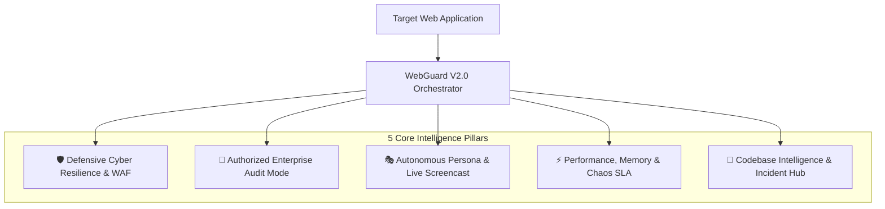
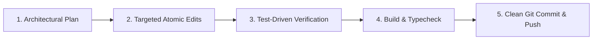

# 🛡️ WebGuard V2.0 Enterprise — AI System Directives & Engineering Rules

> **Purpose:** This document serves as the permanent system blueprint and operational contract for Antigravity (and all AI developer agents) working on the WebGuard repository. All code generation, refactoring, and architectural expansions must strictly adhere to the standards outlined herein.

---

## 1. System Overview & Holistic Capability Baseline

WebGuard is an **autonomous, enterprise-grade Web Quality, Cyber Resilience, and UX Intelligence Platform**. When developing new features, always maintain architectural consistency with the platform's core pillars:

### The 5 Architectural Pillars:
1. **Defensive Cyber Resilience & WAF Verification:**
   - Evaluates perimeter defense by fingerprinting WAFs (Akamai Bot Manager, Cloudflare, AWS WAF, Imperva).
   - Injects harmless synthetic canaries (SQLi, XSS, Path Traversal) to verify that the server blocks payloads cleanly without exposing stack traces or crashing with HTTP 500.
   - Measures burst rate-limiting tolerance with controlled micro-bursts (HTTP 429).
   - Audits public attack surfaces (`.env`, `.git/HEAD`, `dump.sql`) using **magic-byte content validation** to guarantee zero false positives against SPA catch-all routing.
   - Treats active anti-bot barrier interception (e.g. Akamai `Bağlantınız güvensiz`, Reference Code) as a **100/100 verified perimeter defense metric (Fortress Tier)**.

2. **Authorized Enterprise Audit Mode (Sanctioned Testing):**
   - Enables verified site owners to supply their CDN/WAF bypass tokens (`X-Audit-Token`, custom headers, auth cookies).
   - Seamlessly injects these credentials across HTTP clients, Playwright browser contexts, and crawlers to unlock deep UX, cart checkout, and internal page audits without tripping perimeter anti-bot defenses.

3. **Autonomous UX, Persona & Live Screencast Engine:**
   - Simulates diverse user behaviors (Shopper, Rage Tester, Accessibility, Power Explorer) with humanized mouse curves, smooth viewport scrolling, cookie/KVKK banner resolution, and boundary value form testing.
   - Streams live browser viewport frames and real-time AI Action HUD tickers via Chrome DevTools Protocol (CDP) and WebSockets.

4. **Performance, Reliability & SLA Engineering:**
   - Benchmarks Core Web Vitals (LCP, FCP, TTFB) under concurrent synthetic stress.
   - Profiles client-side JavaScript heap growth and detached DOM trees to catch memory leaks.
   - Tests network fault tolerance via chaos fault injection (latency, drops, offline WSOD).
   - Validates responsive layout across mobile, tablet, and desktop viewports.

5. **Codebase Intelligence & Operational Incident Hub:**
   - Performs static AST analysis of full-stack repositories, mapping layers and blast-radius scores.
   - Generates executable Playwright E2E test specs from PRD documents.
   - Auto-heals flaky test locators into resilient role-based selectors.
   - Dispatches formatted incident payloads to enterprise channels (Slack, Microsoft Teams, Discord, Jira, SIEM).

---

## 2. Engineering Principles & Quality Standards

### A. Zero Tailwind CSS — Pure Scoped CSS
- **Rule:** Never introduce Tailwind CSS, PostCSS Tailwind utilities, or inline utility string dumps.
- **Implementation:** Use structured, pure CSS classes located in `frontend/app/globals.css`. Maintain the platform's signature **glassmorphic dark-mode** design language (`rgba(15, 23, 42, 0.85)` background, subtle indigo/emerald borders, JetBrains Mono for metrics).

### B. Strict TypeScript & Complete Type Safety
- **Rule:** Never use `any` unless strictly interfacing with un-typed external JS payloads.
- **Implementation:** Every new schema in `backend/app/models/schema.py` must have an exact mirror interface in `frontend/types/scan.ts`. Maintain complete end-to-end type safety from FastAPI models to React components.

### C. Zero False-Positive Guarantee (Magic-Byte Content Validation)
- **Rule:** Never rely solely on HTTP 200 status codes when auditing web resources.
- **Reasoning:** Modern SPAs (Next.js, React, Vue) return HTTP 200 with `index.html` for non-existent paths.
- **Implementation:** Always validate the body payload with signature checkers (e.g., `.git/HEAD` must start with `ref: refs/`, `.env` must contain `APP_KEY=` or `DB_PASSWORD=`, SQL dumps must contain `CREATE TABLE`).

### D. Ethical, Non-Destructive Operation
- **Rule:** Never attempt volumetric denial-of-service, destructive database manipulation, or unauthorized brute-forcing.
- **Rule:** Never build or deploy automated CAPTCHA/anti-bot bypass scripts. When an access gate is encountered, report the block transparently or use sanctioned enterprise authorization headers (`X-Audit-Token`).

### E. Defensive Fault-Tolerance & Graceful Degradation
- **Rule:** A single scanner or network failure must never crash the entire audit process.
- **Implementation:** Wrap all scanner executions in independent `try-except` blocks. If an endpoint times out or rejects a probe, record the status safely and allow the remaining modules to complete.

---

## 3. High-Performance AI Workflow Protocol

Follow this 5-step operational protocol for every coding request:

1. **Architectural Planning First:**
   - Before writing code for multi-file features, outline the plan (models, services, UI components) to preserve code integrity and prevent regressions across the 22 existing modules.
2. **Targeted, Atomic Edits:**
   - Modify only the required functions and blocks. Do not rewrite or overwrite entire working files indiscriminately.
3. **Companion Test Suite (TDD):**
   - For every new backend service or algorithm, write matching unit tests under `backend/tests/test_*.py`. Verify mocking for external network calls so tests run reliably in offline environments.
4. **Mandatory Build Verification:**
   - Always run the test suite and verify the frontend build:
     - Backend: `$env:PYTHONPATH='backend'; backend\.venv\Scripts\pytest.exe backend/tests/`
     - Frontend: `npm run build --prefix frontend`
   - Fix all compiler or test errors before concluding the turn.
5. **Clean Git Hygiene:**
   - Stage changes cleanly with `git add .`, write a concise conventional commit message (`feat: ...`, `fix: ...`), and push to `origin/main`.

---

## 4. Context Window & Token Efficiency Directives

1. **Concise Communication:** Focus on high-signal architectural clarity. Avoid conversational fluff.
2. **Path Precision:** When referencing files, use exact relative or absolute paths so lookups require zero unnecessary directory traversals.
3. **Session Compaction (`/compact`):** When a development session spans multiple features and accumulates lengthy terminal outputs, recommend or trigger `/compact` to summarize architectural milestones and refresh attention.

---

## 5. Technology Stack Quick Reference

| Component | Technology | Version / Spec | Key Location |
| :--- | :--- | :--- | :--- |
| **Backend Framework** | FastAPI / Uvicorn | Python 3.12 | `backend/app/main.py` |
| **Browser Engine** | Playwright (Headless Chromium) | Async API | `backend/app/scanners/ux/playwright_qa.py` |
| **Data Validation** | Pydantic v2 | Strict Schema | `backend/app/models/schema.py` |
| **HTTP Client** | HTTPX | AsyncClient | `backend/app/services/` |
| **Frontend Framework**| Next.js App Router | Next 16 / React 19 | `frontend/app/` |
| **Styling** | Pure CSS (Glassmorphism) | Zero Tailwind | `frontend/app/globals.css` |
| **Type Definitions** | TypeScript | Strict Mode | `frontend/types/scan.ts` |
| **Test Runner** | Pytest / Pytest-Asyncio | 9.x | `backend/tests/` |
| **Network Endpoints** | REST & WebSockets | Port 8000 (API) / 3000 (UI) | `/api/v1/scan`, `/api/v1/ws/screencast` |
